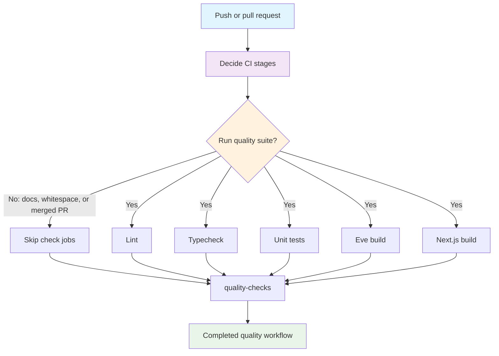

## Workflow Overview

**Purpose**: Validate application and Eve agent changes efficiently while preserving one required quality status for protected branches.
**Trigger Events**: Pushes to `main` or `staging`; pull requests targeting `main` or `staging` when opened, updated, reopened, or marked ready for review.
**Target Environments**: GitHub-hosted Linux runners; Preview environment for application checks.

## Execution Flow Diagram



## Jobs & Dependencies

| Job Name | Purpose | Dependencies | Execution Context |
|----------|---------|--------------|-------------------|
| `decide` | Classify the changed revision and publish the CI/deployment decision | None | Linux runner; repository read access |
| `lint` | Run ESLint | `decide` when checks are enabled | Linux runner; Preview environment |
| `typecheck` | Validate TypeScript types | `decide` when checks are enabled | Linux runner; Preview environment |
| `test` | Run the unit test suite | `decide` when checks are enabled | Linux runner; staging database secret |
| `eve-build` | Compile the Eve agent | `decide` when checks are enabled | Linux runner; Preview environment |
| `next-build` | Create a production Next.js build without network database access | `decide` when checks are enabled | Linux runner; isolated loopback database URL |
| `quality-checks` | Fan in all outcomes into the protected-branch status | `decide`, and all check jobs | Linux runner |

## Requirements Matrix

### Functional Requirements

| ID | Requirement | Priority | Acceptance Criteria |
|----|-------------|----------|-------------------|
| REQ-001 | Run lint, typecheck, tests, Eve build, and Next.js build concurrently when source changes require validation | High | All five checks can execute without dependencies between them and the fan-in passes only when each succeeds |
| REQ-002 | Maintain a single stable required quality status | High | `quality-checks` succeeds for a valid full run and for an intentional skip; it fails on a check failure or cancellation |
| REQ-003 | Skip the suite for documentation-only revisions | High | A revision containing only Markdown or MDX files is classified as documentation-only |
| REQ-004 | Skip the suite for whitespace-only revisions | High | A diff with no substantive change after ignoring whitespace and blank lines is classified as whitespace-only |
| REQ-005 | Skip checks for a revision created by merging a pull request into a deployment branch | High | An associated merged pull request is detected on the branch push and the quality jobs are skipped |
| REQ-006 | Preserve a deterministic build database guard | High | Next.js build-time database access uses an unreachable loopback URL and cannot use staging or production data |
| REQ-007 | Publish a machine-readable decision for the deployment workflow | High | Every successful decision produces a short-lived decision artifact |

### Security Requirements

| ID | Requirement | Implementation Constraint |
|----|-------------|---------------------------|
| SEC-001 | Use least-privilege repository access | Contents and pull-request metadata are read-only |
| SEC-002 | Keep production credentials out of validation | Quality checks may use the existing Preview/staging test inputs; production credentials belong only to deployment |
| SEC-003 | Fail safe when revision classification is unavailable | Unknown diffs run the quality suite and do not authorize deployment |
| SEC-004 | Do not permit build-time access to a real database | The Next.js build must retain the loopback-only database URL |

### Performance Requirements

| ID | Metric | Target | Measurement Method |
|----|-------|--------|-------------------|
| PERF-001 | Quality wall-clock time | Approximately the slowest independent check plus setup | Compare workflow duration before and after parallel execution |
| PERF-002 | Skipped revision cost | Decision job only | Inspect job duration and skipped job count for docs/whitespace changes |
| PERF-003 | Repeat build cost | Warm cache where available | Inspect package-manager, TypeScript, ESLint, and Next.js cache hit rates |

## Input/Output Contracts

### Inputs

```yaml
# Repository triggers
branches: [main, staging]
pull_request_types: [opened, synchronize, reopened, ready_for_review]

# Revision metadata
base_revision: string
head_revision: string
associated_merged_pull_request: boolean

# Runtime values
NODE_ENV: string
DATABASE_URL: secret-or-isolated-test-url
```

### Outputs

```yaml
run_checks: boolean  # Whether the independent quality jobs should execute.
deploy: boolean      # Whether the downstream deployment workflow may deploy.
reason: string       # Stable classification reason.
decision_artifact: file  # Short-lived machine-readable CI decision.
quality-checks: status  # Protected-branch fan-in status.
```

### Secrets & Variables

| Type | Name | Purpose | Scope |
|------|------|---------|-------|
| Secret | Clerk, Blob, Maps, Geoscape, Graph, Novu, AI, ScrapeDo, and Xero settings | Preserve application configuration required by existing validation jobs | Quality workflow |
| Secret | `STAGING_DATABASE_URL` | Unit-test database access | Test job only |
| Variable | `NEXT_PUBLIC_CLERK_SIGN_IN_URL`, `NEXT_PUBLIC_CLERK_SIGN_UP_URL` | Stable route configuration | Quality workflow |
| Variable | `PUPPETEER_SKIP_DOWNLOAD` | Avoid downloading a browser that CI does not launch | Quality workflow |

## Execution Constraints

### Runtime Constraints

- **Timeout**: Uses the platform default unless a job-specific timeout is introduced.
- **Concurrency**: At most one active push validation per branch; in-flight pull-request runs may be superseded.
- **Resource Limits**: One Linux runner per independent job; dependency installation and build caches are reused where valid.

### Environmental Constraints

- **Runner Requirements**: Node.js 24 and pnpm 9-compatible project setup.
- **Network Access**: Package installation and external API metadata access are permitted; Next.js build database access is intentionally unavailable.
- **Permissions**: Repository contents and pull-request metadata are read-only.

## Error Handling Strategy

| Error Type | Response | Recovery Action |
|------------|----------|-----------------|
| Diff classification failure | Run the full quality suite and withhold deployment authorization | Investigate revision metadata or repository state |
| Lint/type/test/build failure | Fail `quality-checks` | Correct the source or rerun after a transient failure is resolved |
| Intentional stage skip | Mark individual checks skipped but allow `quality-checks` to pass | No action required |
| Decision artifact failure | Fail the quality workflow or prevent downstream deployment | Rerun the workflow after artifact service availability returns |

## Quality Gates

### Gate Definitions

| Gate | Criteria | Bypass Conditions |
|------|----------|-------------------|
| Change decision | Revision classification is available | None; unavailable classification is fail-safe |
| Code quality | Lint, typecheck, unit tests, Eve build, and Next.js build succeed | Documentation-only, whitespace-only, or merged-PR push |
| Protected status | Fan-in has no failure/cancellation and the decision job succeeded | Intentional check skips are accepted |

## Monitoring & Observability

### Key Metrics

- **Success Rate**: Track successful full suites separately from intentional skips.
- **Execution Time**: Track decision-only, full-suite, and cache-hit durations.
- **Resource Usage**: Track runner minutes, dependency-cache hits, and Next.js cache hits.

### Alerting

| Condition | Severity | Notification Target |
|-----------|----------|-------------------|
| Protected quality status fails | High | Pull request reviewers and repository checks |
| Classification repeatedly falls back to full suite | Medium | DevOps maintainers |
| Decision artifact is unavailable | High | DevOps maintainers |

## Integration Points

### External Systems

| System | Integration Type | Data Exchange | SLA Requirements |
|--------|------------------|---------------|------------------|
| GitHub repository metadata | Read API | Commit and pull-request association | Available during decision stage |
| GitHub Actions cache | Cache service | Dependency and build cache data | Best effort; cache misses must not fail validation |

### Dependent Workflows

| Workflow | Relationship | Trigger Mechanism |
|----------|--------------|-------------------|
| Deploy to Vercel | Consumes the completed decision artifact | Completed Quality Checks workflow event |

## Compliance & Governance

### Audit Requirements

- **Execution Logs**: Retain standard GitHub Actions logs under repository policy.
- **Approval Gates**: Branch protection must require `quality-checks` for protected branches.
- **Change Control**: Changes to skip rules, deployment authorization, or protected status require review.

### Security Controls

- **Access Control**: Read-only GitHub token for decision metadata.
- **Secret Management**: Repository/environment secrets remain outside source control.
- **Vulnerability Scanning**: Keep action references and dependency setup under normal repository maintenance.

## Edge Cases & Exceptions

### Scenario Matrix

| Scenario | Expected Behavior | Validation Method |
|----------|-------------------|-------------------|
| Only `.md`/`.mdx` files changed | Skip checks and deployment | Inspect decision reason and fan-in status |
| Only spaces, line breaks, or blank lines changed | Skip checks and deployment | Compare substantive diff result |
| Merged pull request push to `main`/`staging` | Skip quality jobs and authorize deployment | Inspect associated pull-request decision |
| Direct source push to `main`/`staging` | Run full suite, then authorize deployment if successful | Inspect push workflow and downstream deployment |
| Pull request from a fork | Run checks without unavailable secrets; never deploy from the pull-request workflow | Inspect event type and workflow permissions |
| Mixed documentation and source changes | Run full suite | Inspect decision reason `source-change` |
| Diff base cannot be resolved | Run checks and withhold deployment | Inspect fallback reason |

## Validation Criteria

### Workflow Validation

- **VLD-001**: Workflow syntax and expressions validate with a GitHub Actions linter.
- **VLD-002**: Independent lint, typecheck, test, Eve build, and Next.js build jobs have no peer dependency on one another.
- **VLD-003**: The fan-in fails for any real job failure or cancellation.
- **VLD-004**: Documentation-only and whitespace-only decisions skip all quality jobs.
- **VLD-005**: The decision artifact is present for every successful decision.
- **VLD-006**: The Next.js build succeeds with the loopback-only database URL.

### Performance Benchmarks

- **PERF-001**: Full-suite wall-clock time is bounded by the slowest independent check plus setup overhead.
- **PERF-002**: Documentation-only and whitespace-only revisions do not install dependencies in check jobs.

## Change Management

### Update Process

1. **Specification Update**: Modify this document first.
2. **Review & Approval**: Obtain DevOps/repository-owner review.
3. **Implementation**: Update workflow or decision logic.
4. **Testing**: Validate syntax and exercise full, skipped, and fallback scenarios.
5. **Deployment**: Merge through the protected branch process.

### Version History

| Version | Date | Changes | Author |
|---------|------|---------|--------|
| 1.0 | 2026-09-17 | Initial split quality workflow specification | DevOps Team |

## Related Specifications

- [Vercel deployment workflow specification](spec-process-cicd-vercel-deployment.md)
- [Quality Checks workflow](../.github/workflows/quality.yml)
- [Vercel deployment workflow](../.github/workflows/deploy.yml)
