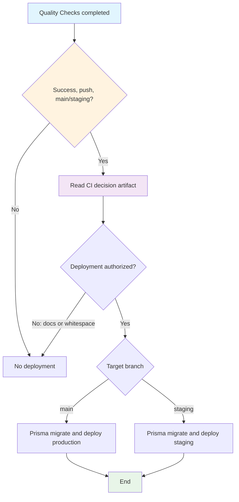

## Workflow Overview

**Purpose**: Deploy approved `main` and `staging` branch revisions to their corresponding Vercel environments.
**Trigger Events**: Completion of the `Quality Checks` workflow.
**Target Environments**: Vercel production for `main`; Vercel staging/preview for `staging`.

## Execution Flow Diagram



## Jobs & Dependencies

| Job Name | Purpose | Dependencies | Execution Context |
|----------|---------|--------------|-------------------|
| `decide-deployment` | Confirm the upstream workflow, branch, and decision artifact authorize deployment | Completed Quality Checks workflow | Linux runner; Actions artifact read access |
| `vercel-deploy-production` | Apply production migrations, build, and deploy the revision | `decide-deployment` | Linux runner; Preview environment; production database and Vercel credentials |
| `vercel-deploy-staging` | Apply staging migrations, build, and deploy the revision | `decide-deployment` | Linux runner; Preview environment; staging database and Vercel credentials |

## Requirements Matrix

### Functional Requirements

| ID | Requirement | Priority | Acceptance Criteria |
|----|-------------|----------|-------------------|
| REQ-101 | Keep deployment in its own workflow | High | Deployment is triggered by the completed quality workflow rather than by peer jobs in the same workflow |
| REQ-102 | Deploy only successful branch pushes | High | Pull-request quality runs, failed runs, cancelled runs, and other events do not deploy |
| REQ-103 | Deploy `main` to production | High | Production credentials, migration target, and production Vercel mode are selected for `main` |
| REQ-104 | Deploy `staging` to preview/staging | High | Staging credentials, migration target, and preview Vercel mode are selected for `staging` |
| REQ-105 | Honor the change decision | High | Documentation-only and whitespace-only decisions do not deploy; merged-PR decisions may deploy without check jobs |
| REQ-106 | Build the exact upstream revision | High | Checkout uses the upstream workflow’s head revision, not the deployment workflow’s default-branch revision |
| REQ-107 | Run database migrations before deployment | High | The target database migration completes before the Vercel build/deploy steps |

### Security Requirements

| ID | Requirement | Implementation Constraint |
|----|-------------|---------------------------|
| SEC-101 | Restrict deployment to trusted repository pushes | Require successful upstream workflow conclusion and `push` event |
| SEC-102 | Use least-privilege artifact access | Deployment reads only Actions artifacts and repository contents |
| SEC-103 | Keep environment credentials scoped | Production and staging database/Vercel secrets are job-specific |
| SEC-104 | Preserve migration safety controls | Database connection normalization and advisory-lock mitigation remain in place |

### Performance Requirements

| ID | Metric | Target | Measurement Method |
|----|-------|--------|-------------------|
| PERF-101 | Deployment start delay | Begin shortly after Quality Checks completion | Measure workflow-run event-to-job-start time |
| PERF-102 | Vercel build duration | Use a matching Next.js cache when available | Inspect cache restore and Vercel build durations |
| PERF-103 | Unnecessary deployment work | Zero deployment jobs for unauthorized decisions | Inspect decision job outputs and skipped deployment jobs |

## Input/Output Contracts

### Inputs

```yaml
upstream_workflow: Quality Checks
upstream_conclusion: success
upstream_event: push
upstream_branch: main | staging
upstream_head_sha: string
ci_decision_artifact: file
```

### Outputs

```yaml
deployment_decision: boolean
deployed_revision: string
deployment_target: production | staging
vercel_deployment: external deployment result
```

### Secrets & Variables

| Type | Name | Purpose | Scope |
|------|------|---------|-------|
| Secret | `PROD_DATABASE_URL` | Production migration target | Production job |
| Secret | `STAGING_DATABASE_URL` | Staging migration target | Staging job |
| Secret | `VERCEL_ORG_ID`, `VERCEL_PROJECT_ID`, `VERCEL_TOKEN` | Vercel project authentication and selection | Deployment jobs |
| Secret | Application integration settings | Runtime/build configuration required by the deployed app | Deployment workflow |
| Variable | `PUPPETEER_SKIP_DOWNLOAD` | Avoid downloading an unused browser binary | Deployment workflow |

## Execution Constraints

### Runtime Constraints

- **Timeout**: Uses the platform default unless a deployment timeout is introduced.
- **Concurrency**: One non-cancellable deployment per target branch.
- **Resource Limits**: One Linux runner per selected deployment target.

### Environmental Constraints

- **Runner Requirements**: Node.js 24 and pnpm 9-compatible project setup, plus the Vercel CLI.
- **Network Access**: Required for database migration, Vercel environment retrieval, and deployment.
- **Permissions**: Read repository contents and read the upstream Actions artifact.

## Error Handling Strategy

| Error Type | Response | Recovery Action |
|------------|----------|-----------------|
| Upstream workflow failure/cancellation | Skip deployment | Fix or rerun Quality Checks |
| Missing or invalid decision artifact | Deployment job cannot authorize | Rerun the upstream workflow or inspect artifact retention |
| Migration failure | Stop before Vercel deployment | Resolve migration/database issue and rerun with care |
| Vercel build failure | Do not publish deployment | Correct build/configuration issue and rerun |
| Vercel deploy failure | Report failed deployment | Retry after confirming target state and credentials |

## Quality Gates

### Gate Definitions

| Gate | Criteria | Bypass Conditions |
|------|----------|-------------------|
| Upstream quality | Quality Checks completed successfully for a branch push | Merged-PR push may have intentionally skipped individual checks |
| Deployment decision | Artifact authorizes deployment | Documentation-only and whitespace-only revisions |
| Migration | Target schema is applied successfully | None |
| Vercel build | Target revision builds successfully | None |

## Monitoring & Observability

### Key Metrics

- **Success Rate**: Track migration, Vercel build, and deployment success independently.
- **Execution Time**: Track decision, migration, Vercel build, and deploy phases.
- **Resource Usage**: Track runner minutes and Next.js cache hit rate.

### Alerting

| Condition | Severity | Notification Target |
|-----------|----------|-------------------|
| Production migration or deployment fails | Critical | Release owner and DevOps maintainers |
| Staging deployment fails | High | Development team |
| Artifact cannot be read | High | DevOps maintainers |

## Integration Points

### External Systems

| System | Integration Type | Data Exchange | SLA Requirements |
|--------|------------------|---------------|------------------|
| GitHub Actions | Workflow event and artifact | Quality conclusion, branch, revision, decision | Trigger after upstream completion |
| PostgreSQL | Migration connection | Prisma migration commands | Target database availability required |
| Vercel | CLI deployment | Pulled environment, build output, deployment | Target project credentials and availability required |

### Dependent Workflows

| Workflow | Relationship | Trigger Mechanism |
|----------|--------------|-------------------|
| Quality Checks | Upstream producer | `workflow_run` completion event |

## Compliance & Governance

### Audit Requirements

- **Execution Logs**: Retain migration and deployment logs under repository policy.
- **Approval Gates**: Protect production deployment credentials with the configured GitHub environment controls.
- **Change Control**: Review branch routing, migration behavior, and deployment authorization changes.

### Security Controls

- **Access Control**: Deployment is limited to successful push results on named deployment branches.
- **Secret Management**: Database and Vercel credentials are repository/environment secrets.
- **Vulnerability Scanning**: Maintain action, CLI, and dependency versions through normal updates.

## Edge Cases & Exceptions

### Scenario Matrix

| Scenario | Expected Behavior | Validation Method |
|----------|-------------------|-------------------|
| Pull-request Quality Checks completes | Do not deploy | Confirm upstream event is not `push` |
| Direct source push succeeds | Deploy the target branch | Confirm decision artifact authorizes deployment |
| Merged PR push succeeds with checks skipped | Deploy the merged revision | Confirm decision reason is merged pull request |
| Documentation-only push | Do not deploy | Confirm decision reason is documentation-only |
| Whitespace-only push | Do not deploy | Confirm decision reason is whitespace-only |
| Both `main` and `staging` are not selected | Do not deploy | Confirm branch gate rejects the event |
| Concurrent pushes to one target | Preserve non-cancellable target deployment ordering policy | Inspect concurrency group behavior |

## Validation Criteria

### Workflow Validation

- **VLD-101**: Workflow syntax and `workflow_run` expressions validate with a GitHub Actions linter.
- **VLD-102**: Pull-request completion cannot satisfy the deployment event gate.
- **VLD-103**: The exact upstream head revision is deployed.
- **VLD-104**: Production and staging select distinct database and Vercel modes.
- **VLD-105**: Unauthorized decisions skip both deployment jobs.
- **VLD-106**: Migrations precede the Vercel build and deployment.

### Performance Benchmarks

- **PERF-101**: Decision-only upstream runs do not install application dependencies in deployment jobs.
- **PERF-102**: Deployment restores a matching Next.js cache when the upstream push created one.

## Change Management

### Update Process

1. **Specification Update**: Modify this document first.
2. **Review & Approval**: Obtain DevOps/repository-owner review.
3. **Implementation**: Update workflow routing or deployment steps.
4. **Testing**: Validate push, pull-request, skipped, migration-failure, and deployment-failure paths.
5. **Deployment**: Merge through the protected branch process.

### Version History

| Version | Date | Changes | Author |
|---------|------|---------|--------|
| 1.0 | 2026-09-17 | Initial standalone Vercel deployment specification | DevOps Team |

## Related Specifications

- [Quality Checks workflow specification](spec-process-cicd-quality-checks.md)
- [Quality Checks workflow](../.github/workflows/quality.yml)
- [Vercel deployment workflow](../.github/workflows/deploy.yml)
